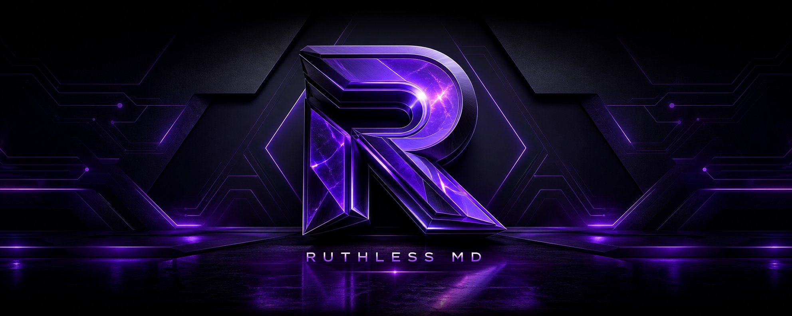

<div align="center">



# ⚡ RUTHLESS MD
**Your WhatsApp. Your bot. Your rules.**

[](https://nodejs.org/)
[](https://www.whatsapp.com/)
[](docs/setup-and-privacy.md)

[](https://github.com/RUTH-BOT-TECH/RUTHLESS-BOT/stargazers)
[](https://github.com/RUTH-BOT-TECH/RUTHLESS-BOT/forks)

</div>

## 🔑 1. Get your session ID

Choose **Pairing code** or **Scan QR** on the pairing site. Your ID is sent privately to your WhatsApp—not shown on the site.

> The pairing site is built but **not publicly hosted yet**. [Pairing-site setup](docs/setup-and-privacy.md#pairing-service-operator-setup)

## 🚀 2. Deploy your bot

[](https://dashboard.render.com/blueprint/new?repo=https%3A%2F%2Fgithub.com%2FRUTH-BOT-TECH%2FRUTHLESS-BOT)
[](https://heroku.com/deploy?template=https://github.com/RUTH-BOT-TECH/RUTHLESS-BOT)
[](https://railway.com/new)

On Render, enter **`SESSION_ID`** and **`OWNER_NUMBER`** (international digits, no `+`). A newly issued ID includes the pairing-service address. Railway requires importing the repository manually.

## 🛡️ Keep it safe

- Your session ID controls your linked account. **Never share it**; delete the WhatsApp message after deploying.
- Use an ID only from a pairing site you trust. **Never run the same ID on two hosts**: WhatsApp may disconnect both.
- Experimental project: real WhatsApp pairing and delivery are not yet verified. Free hosts may sleep or lose local data.
- Pairing-site operators: [setup, privacy, backup & test guide](docs/setup-and-privacy.md).

## 💻 Run locally

```bash
npm install
npm start
```

Node.js 20.19+ is required. Set your environment variables first; see [`.env.example`](.env.example).

---
<div align="center">Built with Baileys · Creator credit: <b>2348021016309</b></div>
